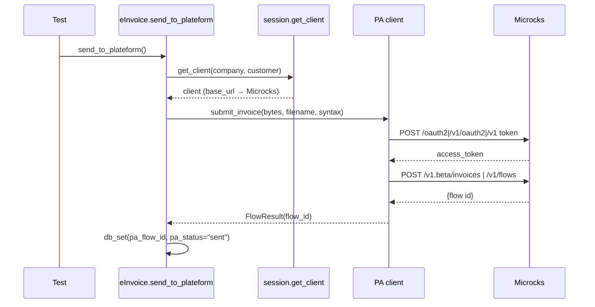
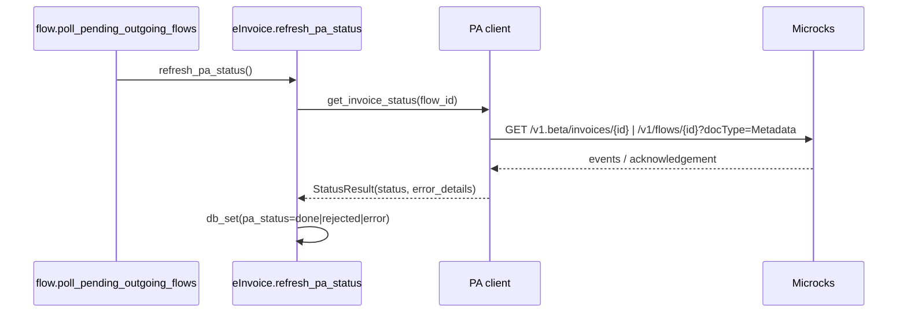
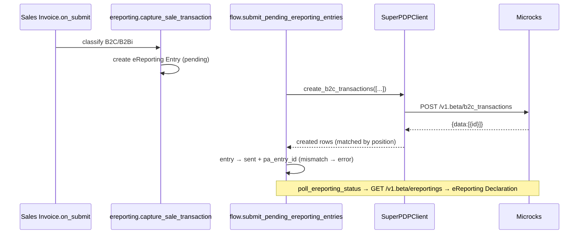
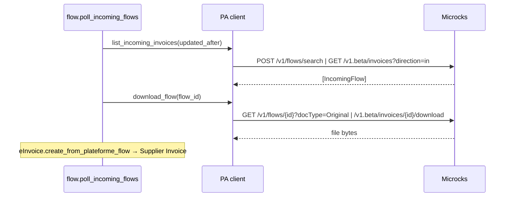
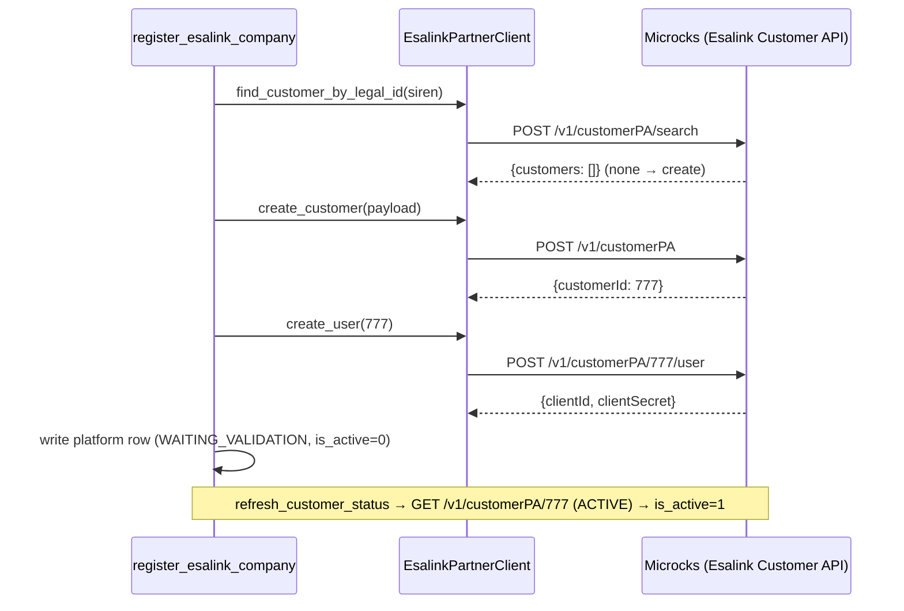

# PA integration tests (Microcks-backed)

End-to-end tests that drive **real HTTP** from the three Plateforme Agréée (PA)
connection modes to a [Microcks](https://microcks.io) mock server, covering the
full e-invoicing and e-reporting use cases plus French annuaire registration.

Unlike the unit tests (which patch `client._request`), these exercise the whole
stack — `get_client` → the concrete client → `requests` → HTTP → response mapping
→ persisted state — so they catch auth-flow, header, URL-assembly, serialization
and status-mapping regressions that mocks at the method boundary cannot.

## How it works

- The PA clients build every URL as `base_url + path`. A single seam,
  `plateforme_agreee/_microcks.py::microcks_base_url`, redirects that base to the
  Microcks mock **only when `microcks_url` is set in site_config** — wired into
  `session._build_client` (SuperPDP / Custom / Esalink) and
  `esalink_provisioning.esalink_partner_config` (Esalink Customer API). Inert in
  production.
- Microcks serves each PA "service" at `{microcks_url}/rest/{Title}/{Version}` and
  dispatches on the OpenAPI operation path. The mock specs live in
  [`etransactions/components/mocks`](../../components/mocks) — one per service; the
  `info.title`/`info.version` must match `_MICROCKS_SERVICES` in `_microcks.py`.
- The suite **skips cleanly** when `microcks_url` is unset or Microcks is
  unreachable (`base.MicrocksTestCase.setUpClass`), so it never blocks a run
  without Microcks.

### Run it locally

```bash
./scripts/microcks-up.sh                                  # start + seed the 4 mocks
bench --site <site> set-config microcks_url http://localhost:8585
bench --site <site> run-tests --app etransactions \
    --module etransactions.tests.integration.test_einvoicing_e2e
# …repeat for test_ereporting_e2e and test_annuaire_esalink_e2e
bench --site <site> set-config microcks_url ""            # prove the skip contract
```

CI brings Microcks up as a service and sets `microcks_url` automatically (see
`.gitlab-ci.yml`).

## Coverage matrix

| Scenario | Custom (AFNOR) | SuperPDP | Esalink | Test |
|---|:-:|:-:|:-:|---|
| B2B send (Factur-X) → flow id + `sent` | ✅ | ✅ | ✅ | `test_einvoicing_e2e::test_b2b_send_roundtrips_flow_id` |
| B2G classification + send | ✅ | ✅ | ✅ | `…::test_b2g_classification_and_send` |
| UBL/Peppol send (raw XML) | ✅ | ✅ | ✅ | `…::test_ubl_peppol_send_raw_xml` |
| Status poll → `done` | ✅ | ✅ | ✅ | `…::test_status_refresh_marks_done` |
| Status poll → rejected/error + reason | ✅ | ✅ | ✅ | `…::test_status_refresh_marks_rejected` |
| Directory lookup by SIREN | ✅ | ✅ | ✅ | `…::test_directory_lookup_over_http` |
| Incoming flow list + download | ✅ | — | ✅ | `…::test_incoming_flow_roundtrip` |
| Auth handshake (healthcheck) | ✅ | ✅ | ✅ | `…::test_healthcheck_authenticates` |
| B2C capture → `eReporting Entry` | — | ✅ | — | `test_ereporting_e2e::test_b2c_sale_is_captured` |
| Batch submit → `sent` + `pa_entry_id` | — | ✅ | — | `…::test_submit_pending_entries_marks_sent` |
| Count-mismatch → `error` | — | ✅ | — | `…::test_count_mismatch_marks_error` |
| Declaration status poll | — | ✅ | — | `…::test_poll_status_upserts_declaration` |
| B2C send hard-block | — | ✅ | — | `…::test_b2c_send_is_blocked` |
| Annuaire: provision account | — | — | ✅ | `test_annuaire_esalink_e2e::test_register_company_provisions_account` |
| Annuaire: status poll activates | — | — | ✅ | `…::test_status_poll_activates_platform` |
| Annuaire: identifier register/list/remove | — | — | ✅ | `…::test_directory_identifier_register_list_remove` |
| Annuaire: resend KYC email | — | — | ✅ | `…::test_resend_kyc_email` |
| Annuaire: partner-creds gate | — | — | ✅ | `…::test_registration_blocked_without_partner_credentials` |

E-reporting is SuperPDP-only (capability `ereporting`); AFNOR/Esalink stub those
endpoints. Incoming lifecycle CDAR flows are exercised at the list/download HTTP
level only — parsing a full CDAR payload is covered by `tests/test_cdar.py`.

## Tested flows

### E-invoice send



### Status / lifecycle poll



### B2C e-reporting



### Incoming flow



### Esalink annuaire registration



## Per-mode mock map

| Mode | `platform_type` | Client | Mock spec | Microcks service | Auth |
|---|---|---|---|---|---|
| Generic AFNOR | `Custom` | `AFNORClient` | `afnor-mock.yaml` | `AFNOR+PA+API/1.0.0` | `POST /v1/oauth2/token` (query) |
| SuperPDP | `SuperPDP` | `SuperPDPClient` | `superpdp-mock.yaml` | `SuperPDP+PA+API/1.0.0` | `POST /oauth2/token` (OAuth2) |
| Esalink (invoices) | `Esalink` | `EsalinkClient` | `esalink-mock.yaml` | `Esalink+PA+API/1.0.0` | `POST /v1/token` + `hubtimize-api-key` |
| Esalink (annuaire) | — | `EsalinkPartnerClient` | `esalink-customer-mock.yaml` | `Esalink+Customer+API/1.0.0` | `POST /v1/token` + `hubtimize-api-key` |

**Scenario selectors** — the mock returns a specific response by request value, so an
assertion traces back to a named example:

- Flow status: invoice/flow id `…-FLOW-OK`/`90001` → accepted, `…-FLOW-REJECTED`/`90002`
  → rejected/error (carries a reason), `…-FLOW-PENDING`/`90003` → pending.
- E-reporting: `POST /v1.beta/b2c_transactions` returns one row, so submitting **one**
  entry matches (→ `sent`) and **two** mismatch (→ `error`).
- Annuaire: `POST /v1/customerPA` mints customer `777`; `GET /v1/customerPA/777`
  reports `activationStatus: ACTIVE` so the status poll flips the platform active.

> Microcks does not reliably dispatch on a colon-embedded path segment
> (`/v1/siren/code-insee:{siren}`) or on POST request bodies, so those operations
> return a single deterministic example rather than varying by request.
